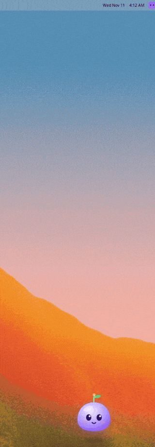
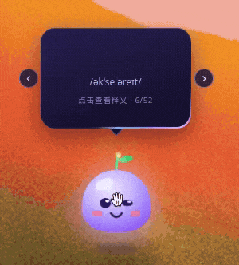
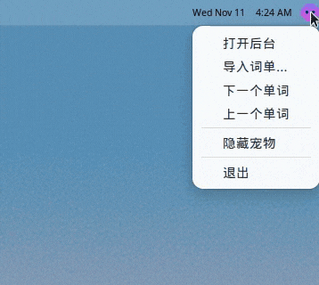

# VocabPet 桌面宠物背单词

VocabPet 是一只待在 Windows 桌面上的背单词宠物。平时它只占屏幕右下角的一小块，鼠标移上去才翻出单词；托盘里有一枚紫色图标，学习记录都在后台。

绿色版下载：[VocabPet v1.0.0](https://github.com/dijiuyue/vocab-pet/releases/tag/v1.0.0)（`VocabPet-win32-x64.zip`）。解压后双击 `VocabPet.exe`。第一次打开若出现 SmartScreen「Windows 已保护你的电脑」，点「更多信息 → 仍要运行」。程序未签名，这是正常提示。

下面的动图都是从正在运行的程序里录的。

## 待在右下角


窗口没有边框、背景透明，始终浮在其他窗口上面，也不进任务栏。默认贴在主屏幕工作区右下角（距右 40 像素、距下 20 像素）。宠物本身会上下浮动、轻轻呼吸、眨眼，头顶的嫩芽会晃。

Windows 上，窗口里的空白处是点得穿的，只有宠物和单词气泡接鼠标，不会挡住你点别的程序。

托盘图标是一枚紫色圆点，提示文字是「VocabPet 桌面背单词」。



单击托盘图标会在「显示」和「隐藏」之间切换，这个选择会记住，下次启动保持。关掉后台窗口不会退出，宠物继续留在桌面上。程序已经在跑的时候再打开一次，不会多出一只宠物，而是直接打开后台。

## 移上去看单词


鼠标移到宠物上，头顶弹出单词卡片：

- 单词逐个字母跳出来。10 到 12 个字母用小一号，13 个及以上再小一号
- 有音标就显示在单词下面
- 底部是「点击查看释义 · 当前序号/总词数」
- 这一下记入今天的「浏览」。同一个词同一天只计一次

鼠标离开大约 0.65 秒后，气泡收起，卡片翻回正面。

## 点一下看释义


点单词卡片，卡片翻到背面：中文释义，有例句就写在下面（太长会在卡片里截断）。这一下记入今天的「查看释义」。再点一次翻回正面。

点宠物本身时，移动不超过 4 像素算点击：气泡还没开，就先把单词弹出来，宠物会跳一下；气泡已经开着，再点一下也会翻转卡片。

## 上一个、下一个



气泡两侧的 ‹ › 分别是上一个、下一个。到词单末尾会回到第一个，到开头再往前会去到最后一个。切换时卡片重新播放进场动画，并记一次浏览。手动换词会把自动换词的倒计时清零重计。

右键菜单和托盘菜单里也有「上一个单词」「下一个单词」。

## 到点自动换词


默认每 30 分钟自动切到下一个单词。程序大约每 30 秒看一次时间，所以到点之后最多再等约 30 秒才会真正换过去。后台里的倒计时按设定的整段间隔计算，走到 0 之后，宠物可能还要再过一会儿才换。

换词时如果气泡是关着的，宠物头顶会弹出 **NEW**，旁边的光圈一起闪。鼠标移上去看这个新词之后，徽章消失。气泡当时开着的话，卡片直接换成新词，不显示徽章。

间隔可以在后台改成 1 到 1440 分钟。改完倒计时从现在重新算。

## 拖到别处


按住宠物拖动。移动超过大约 4 像素就当成拖动，不会误触发点击。松手后窗口位置写进数据文件，下次启动还在原地。如果保存的位置已经不在任何一块屏幕的工作区里（比如拔掉了副屏），会回到主屏幕右下角。

## 右键菜单和托盘菜单


在宠物上右键，或在托盘图标上右键，菜单是同一套：

| 菜单项 | 作用 |
|---|---|
| 打开后台 | 打开学习记录窗口；已经开着就把它提到前面 |
| 导入词单… | 选择 `.txt` / `.csv` / `.tsv` 词单 |
| 下一个单词 | 同气泡上的 › |
| 上一个单词 | 同气泡上的 ‹ |
| 隐藏宠物 / 显示宠物 | 跟单击托盘图标一样，并记住 |
| 退出 | 退出整个程序（会先把数据写盘） |



单击托盘图标：显示或隐藏宠物。双击托盘图标：打开后台。

## 后台


窗口标题是「VocabPet 后台」。上面四格是：

| 数字 | 含义 |
|---|---|
| 今日浏览 | 今天看过单词面的个数。同一个词今天只算一次 |
| 今日查看释义 | 今天翻开过释义的个数，同样每个词只算一次 |
| 连续天数 | 从今天往前，连续有浏览记录的天数。今天还没背的话，从昨天开始数；中间空一天就断开 |
| 累计学过 | 迄今看过的不同单词数，换了词单也还留在这个总数里 |

中间是学习趋势。紫色柱是浏览，里面的粉色柱是看释义。可以在「14 天」和「30 天」之间切换。14 天标出每一天，30 天大约每 3 天标一次，最右一天写「今天」。鼠标停在某一天上，会显示日期和当天的两个数字。纵轴按 5 的倍数取整，最少到 5。

右边是当前词单：

- 圆环是「这张词单里已经看过的词 / 词单总词数」
- 词单名字。内置的是「默认词单（CET4/雅思 52 词）」，52 个词都有单词、释义、音标和例句
- 「当前第 N 个单词」
- 「下一个单词：M 分 SS 秒后」，按上面的间隔倒计时

设置：

- **换词间隔**：1–1440 的整数，单位分钟。改完会提示「已设置：每 N 分钟换一个单词」，倒计时从现在重计
- **导入词单**：弹出文件选择（词单，或所有文件）。成功会提示「导入成功：N 个单词」，词单名用文件名（去掉扩展名），进度回到第 1 个，并当作一条新词（气泡关着时会出现 NEW）。一个词都没解析出来时，会提示「没有识别到单词」，原来的词单不动
- **清空学习进度**：先确认。对话框写着「确定清空所有学习记录吗？」，说明是「每日统计和进度都会被清除，词单保留。」。确认后统计、累计和当前序号都清掉，词单还在，并从第 1 个词重新计时。完成后提示「学习进度已清空」

最下面是「今天背的单词」，后看的排在前面。翻开过释义的会标「已看释义」。今天还没背时，这里写：「今天还没有背单词哦～把鼠标移到桌面宠物上看看吧 ✨」。

## 词单格式

支持 `.txt`、`.csv`、`.tsv`，编码 UTF-8（文件开头的 BOM 会自动去掉）。Excel 导出请选「CSV UTF-8」。

```
abandon,v. 放弃；抛弃,/əˈbændən/,They had to abandon the car.
ability	n. 能力；才能	/əˈbɪləti/	She has the ability to learn fast.
sun 太阳
"run, ran","v. 跑，""奔跑"""
```

规则：

- 一行一个词。空行跳过。`#` 开头是注释
- 行里有制表符就按 Tab 分列；否则有逗号就按 CSV 分列（字段可以用双引号包起来，引号里的引号写成 `""`）；否则按「第一个词 + 其余全部当作释义」
- 第 1 列是单词，第 2 列是释义。没有释义的行丢掉
- 第 3 列及之后：写成 `/音标/` 或 `[音标]` 的当作音标，其余接成例句（多段用空格连起来）
- 释义里本身有英文逗号时，用双引号包住这一列，或者改用 Tab
- 第一列是 `word` 或 `单词`（不区分大小写）的表头行会跳过，例如 `word,meaning`

内置例句见 `assets/default-words.tsv`，测试样例在 `test/samples/`。

## 数据放在哪

Windows：

```
%APPDATA%\VocabPet\vocabpet-data.json
```

也就是 `C:\Users\<用户名>\AppData\Roaming\VocabPet\vocabpet-data.json`。

里面有：当前词单和看到第几个、换词间隔、宠物是否显示、宠物位置、每天的浏览/看释义记录、每个词第一次见到的日期。修改会自动保存，退出时再写一次。

## 开发

```
npm install
npm start            # 运行
npm test             # 词单解析单元测试
npm run shots        # 截图自检，写出 screenshots/*.png
npm run pack:win     # 打包 Windows x64 绿色版到 dist/VocabPet-win32-x64/
```

Linux 上跑截图可以用 `xvfb-run npm run shots`。截图模式使用临时数据目录，不会改你平时的学习记录，并会填一些历史数据让后台的图有内容。

在 Linux 上从源码运行时，数据在 `~/.config/VocabPet/vocabpet-data.json`（或 `$XDG_CONFIG_HOME/VocabPet/`）。Linux 不支持窗口空白处点击穿透，整块小窗口都会接鼠标；Windows 上只有宠物和气泡接鼠标。
